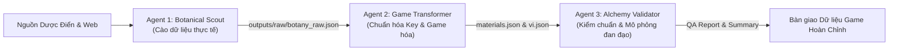

# HỆ THỐNG XÂY DỰNG DỮ LIỆU GAME THẢO DƯỢC & ĐAN ĐẠO (HERBAL & ALCHEMY ENGINE)

Hệ thống tự động hóa đa Agent (Multi-Agent Automation) dùng để thu thập thông tin thực tế của các loại thảo dược đông y, "game hóa" thành tài nguyên game (Game Materials), chuẩn hóa dữ liệu đa ngôn ngữ (Localization-Ready) và mô phỏng cơ chế Luyện Đan (Alchemy) theo thuật toán **Ngũ Hành + Cổ Phương Quân-Thần-Tá-Sứ**.

---

## 1. TÍNH NĂNG NỔI BẬT

1. **Chuẩn Hóa Đa Ngôn Ngữ (Localization First):**
   - File dữ liệu lõi `outputs/processed/materials.json` chỉ lưu trữ các mã định danh (`key`).
   - Mọi văn bản hiển thị (tên thảo dược, mô tả, nơi sinh, khí hậu, hiệu ứng) được quản lý độc lập tại `outputs/locales/vi.json` (dễ dàng bổ sung `en.json`, `zh.json` trong tương lai mà không phải sửa logic game).
2. **Dữ Liệu Thảo Dược Trung Thực (Chống Bịa Đặt):**
   - Thu thập hình thái học, môi trường sống, tính vị đông y và công dụng thực tế từ các nguồn dược điển chính thống.
3. **Game Hóa Khoa Học (Gamification):**
   - Phân tách rõ ràng giữa **Sinh Khí (HP)** và **Nguyên Khí (MP)**.
   - Phân biệt giữa **Hồi phục tức thì (Flat)**, **Tốc độ hồi/giây (Regen)** và **Cố bản bồi nguyên (Tăng Max)**.
   - Mỗi thảo dược có 1–5 công dụng chính diện và 1–3 công dụng ẩn đặc thù (kỳ ngộ, biến dị ngoại hình như bốc hỏa đầu trọc, liệt dương, cuồng bạo, phát quang...).
4. **Hệ Thống Luyện Đan Toán Học (Công Thức Thay Vì Hardcode):**
   - Dược lực tính toán theo niên đại: $P = \text{Base} \times (1 + \log_{10}(\text{Years})) \times \text{GradeMultiplier}$.
   - Tỷ lệ cổ phương: **Quân (50%) - Thần (25%) - Tá (15%) - Sứ (10%)**.
   - Tự động phát hiện đan dược **Cực Phẩm** (Tương sinh liên hoàn) hoặc **Nổ Lò** (Tương khắc gay gắt hoặc Đại Hàn gặp Đại Nhiệt).

---

## 2. KIẾN TRÚC 3 SUB-AGENT



- 📄 [**`.agents/botanical_scout.md`**](.agents/botanical_scout.md): Thu thập đặc tính thực vật học thực tế.
- 📄 [**`.agents/game_transformer.md`**](.agents/game_transformer.md): Ánh xạ taxonomy chuẩn, phân tách HP/MP, sinh key localization.
- 📄 [**`.agents/alchemy_validator.md`**](.agents/alchemy_validator.md): Kiểm tra 100% Schema Pydantic, đối soát 100% Key Parity và chạy thử nghiệm luyện đan.

---

## 3. CẤU TRÚC THƯ MỤC DỰ ÁN

```text
data-material-plants/
├── .agents/                        # Prompt & Rules chi tiết của từng Sub-Agent
│   ├── botanical_scout.md          # Rule cho Agent 1
│   ├── game_transformer.md        # Rule cho Agent 2
│   └── alchemy_validator.md       # Rule cho Agent 3
├── documents/                      # Tài liệu thiết kế hệ thống tổng thể
│   └── game_herbal_system_design.md
├── src/                            # Mã nguồn lõi của hệ thống
│   ├── models/
│   │   └── schemas.py              # Pydantic Schemas & Danh mục Taxonomy Enums
│   ├── alchemy/
│   │   └── formula.py              # Thuật toán tính Dược lực, Quân-Thần-Tá-Sứ & Nổ Lò
│   ├── agents/
│   │   ├── botanical_scout.py      # Module thực thi Agent 1
│   │   ├── game_transformer.py     # Module thực thi Agent 2
│   │   └── alchemy_validator.py    # Module thực thi Agent 3
│   └── pipeline.py                 # Bộ điều phối toàn bộ chu trình xử lý
├── tests/
│   └── test_alchemy.py             # Bộ Unit test kiểm thử công thức luyện đan
├── outputs/                        # Kết quả đầu ra
│   ├── raw/
│   │   └── botany_raw.json         # Dữ liệu thực vật học thô
│   ├── processed/
│   │   ├── materials.json          # Dữ liệu Game thảo dược (100% Localization Keys)
│   │   ├── materials_summary.csv   # Bảng tổng hợp tra cứu dạng bảng trực quan
│   │   └── qa_report.json          # Báo cáo kiểm định chất lượng và mô phỏng đan dược
│   └── locales/
│       └── vi.json                 # Từ điển bản dịch Tiếng Việt toàn diện
├── main.py                         # File điểm vào (Entry Point) chạy pipeline
├── requirements.txt                # Danh sách thư viện Python tối ưu
├── .gitignore                      # Cấu hình bỏ qua file tạm & API key
└── README.md                       # Hướng dẫn sử dụng chi tiết
```

---

## 4. HƯỚNG DẪN CÀI ĐẶT TỪ ĐẦU (STEP-BY-STEP SETUP)

### Bước 1: Yêu cầu môi trường
- Hệ điều hành: Linux / macOS / Windows.
- Python phiên bản: **Python 3.10 trở lên**.

### Bước 2: Tạo và kích hoạt môi trường ảo (Virtualenv)
```bash
# Tạo môi trường ảo
python3 -m venv myenv

# Kích hoạt môi trường (trên Linux / macOS):
source myenv/bin/activate

# (Hoặc trên Windows PowerShell):
# .\myenv\Scripts\Activate.ps1
```

### Bước 3: Cài đặt các thư viện phụ thuộc
Dự án sử dụng các thư viện cốt lõi, gọn nhẹ:
```bash
pip install -r requirements.txt
```
*Danh sách gồm 4 thư viện chính:*
- `google-genai`: SDK gọi Gemini API với structured output Pydantic.
- `pydantic`: Kiểm chuẩn dữ liệu và định nghĩa Enums/Schemas.
- `python-dotenv`: Nạp biến môi trường tự động.
- `python-frontmatter`: Đọc prompt và cấu hình trong `.agents/*.md`.

### Bước 4: Thiết lập API Key
Tạo file `.env` tại thư mục gốc của dự án:
```bash
echo "GEMINI_API_KEY=your_gemini_api_key_here" > .env
```
*(Thay `your_gemini_api_key_here` bằng Gemini API Key của bạn từ Google AI Studio).*

---

## 5. HƯỚNG DẪN CHẠY VÀ KIỂM THỬ

### 1. Chạy Unit Test kiểm thử thuật toán Đan Đạo (Không tốn token API)
Chạy bộ test kiểm tra công thức tính dược lực, chuỗi tương sinh ngũ hành và điều kiện nổ lò:
```bash
python -m unittest tests/test_alchemy.py
```
*Kết quả mong đợi:*
```text
Ran 3 tests in 0.001s
OK
```

### 2. Khởi chạy Pipeline linh hoạt (Giao diện Tương tác & Tham số Dòng Lệnh)

#### Cách 1: Chạy giao diện tương tác (Interactive Mode)
Chỉ cần gõ:
```bash
python main.py
```
Hệ thống sẽ hiển thị số lượng thảo dược hiện có trong kho và cung cấp 3 lựa chọn:
```text
============================================================
   HỆ THỐNG AGENT THẢO DƯỢC & ĐAN ĐẠO (MULTI-AGENT)
============================================================
📊 Kho dữ liệu thô hiện tại đang có: 13 thảo dược.

Vui lòng chọn chế độ hoạt động:
  [1] Cào cho ĐỦ số lượng mục tiêu (Ví dụ: đã có 13, nhập 100 -> cào thêm 87)
  [2] Cào THÊM số lượng chỉ định (Ví dụ: đã có 13, nhập 50 -> cào thêm 50 mới)
  [3] ĐỒNG BỘ RULE MỚI: Game hóa lại toàn bộ thảo dược đã cào (Không tốn token cào lại)

Nhập lựa chọn (1, 2 hoặc 3) [Mặc định: 1]: 
```

#### Cách 2: Chạy trực tiếp qua tham số dòng lệnh (CLI Parameters)
- **Cào cho ĐỦ số lượng tổng (Ví dụ: mục tiêu 100 cây):**
  ```bash
  python main.py --mode fill --amount 100
  ```
  *(Nếu trong kho đã có 13 cây, hệ thống sẽ tự động cào thêm 87 cây mới chưa trùng lặp. Nếu đã có $\ge 100$, hệ thống báo đã đủ và dừng ngay, không tốn token API).*

- **Cào THÊM số lượng mới (Ví dụ: cào thêm 50 cây mới hoàn toàn):**
  ```bash
  python main.py --mode add --amount 50 --batch-size 10
  ```

- **Đồng bộ lại Rule/Prompt mới cho toàn bộ dữ liệu đã cào:**
  ```bash
  python main.py --retransform
  ```
  *(Khi bạn tinh chỉnh prompt trong `.agents/game_transformer.md` hoặc thay đổi cách map thuộc tính, lệnh này sẽ Game Hóa lại toàn bộ kho dữ liệu thô mà TUYỆT ĐỐI KHÔNG tốn thời gian hay token để cào lại từ internet).*

---

## 6. CƠ CHẾ CHỐNG TRÙNG LẶP & ĐỘ ỔN ĐỊNH PRODUCTION

1. **Bóc tách Bí danh Đa tầng (Alias-Aware Deduplication):**
   - Tự động tách các tên ghép, tên gọi khác ngăn cách bởi dấu gạch chéo `/`, dấu phẩy `,` hoặc dấu ngoặc đơn `()` (Ví dụ: *"Kê Huyết Đằng / Cỏ Máu (Spatholobus suberectus)"* sẽ được bóc tách và ghi nhận đồng thời cả *Kê Huyết Đằng*, *Cỏ Máu* và *Spatholobus suberectus* vào tập chống trùng lặp).
   - Nếu ở các mẻ cào sau AI đề xuất bất kỳ bí danh nào trong số này, hệ thống sẽ tự động phát hiện và bỏ qua ngay.
2. **Chống trùng lặp Mã Định Danh (`id` Collision Resolution):**
   - Nếu hai thảo dược khác nhau bị AI sinh trùng ID (hoặc trùng tên không dấu), Python tự động nhận diện và gán hậu tố duy nhất (`mat_hoang_ky`, `mat_hoang_ky_2`), đồng thời đồng bộ toàn bộ key bản dịch đối ứng.
3. **Cơ chế Tự động phục hồi khi gặp lỗi API (Exponential Backoff):**
   - Tự động giãn cách thời gian giữa các batch (`time.sleep(2.0)`) để chống chạm trần Rate Limit (RPM).
   - Khi gặp sự cố mạng hoặc lỗi quá tải tạm thời từ máy chủ Google (`HTTP 429` hoặc `HTTP 503 UNAVAILABLE`), hệ thống tự động tạm nghỉ và thử lại với thời gian chờ tăng lũy tiến (2s, 4s, 8s, 16s) mà không làm sập pipeline.
4. **Lưu trữ lũy tiến (Incremental Saving):**
   - Dữ liệu thô và dữ liệu game hóa được ghi đĩa ngay sau mỗi batch, đảm bảo an toàn dữ liệu 100%.
```

---

## 7. CẤU TRÚC DỮ LIỆU ĐẦU RA MẪU

### Mẫu `materials.json` (Thuần mã Key):
```json
{
  "id": "mat_nhan_sam",
  "name_key": "mat_nhan_sam_name",
  "desc_key": "mat_nhan_sam_desc",
  "grade_key": "grade_huyen_pham",
  "habitat_key": "hab_nui_cao",
  "climate_key": "clim_on_hoa",
  "element_key": "elem_tho",
  "nature_key": "nat_vi_nhiet",
  "base_potency": 800,
  "growth_years_range": [10, 300],
  "main_effects": [
    { "effect_key": "eff_boost_max_vitality", "weight": 0.9 },
    { "effect_key": "eff_restore_vitality", "weight": 0.8 },
    { "effect_key": "eff_restore_energy", "weight": 0.7 }
  ],
  "hidden_effects": [
    { "effect_key": "eff_hidden_berserk", "trigger_chance": 0.15 }
  ]
}
```

### Mẫu `locales/vi.json` (Bản dịch tiếng Việt):
```json
{
  "mat_nhan_sam_name": "Nhân Sâm Thiên Niên",
  "mat_nhan_sam_desc": "Thân rễ kết tinh linh khí tựa hình nhân, ẩn mình nơi thâm sơn cùng cốc. Rễ phụ chằng chịt bám sâu dưới lớp đất lạnh, tỏa ra mùi linh hương thanh khiết...",
  "grade_huyen_pham": "Huyền Phẩm",
  "hab_nui_cao": "Núi Cao",
  "clim_on_hoa": "Ôn Hòa",
  "elem_tho": "Thổ",
  "nat_vi_nhiet": "Vi Nhiệt",
  "eff_boost_max_vitality": "Cố Bản Bồi Nguyên Khí Huyết (Tăng HP Max)",
  "eff_restore_vitality": "Tăng Cường Khí Huyết (Hồi HP)",
  "eff_restore_energy": "Tăng Cường Nguyên Khí (Hồi MP)",
  "eff_hidden_berserk": "Khí huyết nghịch chuyển (Cuồng bạo)"
}
```

