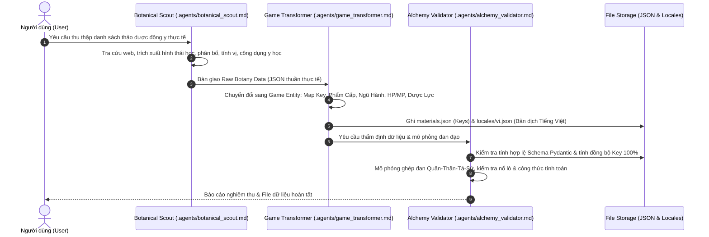

# TÀI LIỆU THIẾT KẾ HỆ THỐNG DỮ LIỆU THẢO DƯỢC & ĐAN ĐẠO (GAME HERBAL & ALCHEMY SYSTEM DESIGN)

> **Phiên bản:** 1.0  
> **Mục tiêu:** Xây dựng hệ thống dữ liệu thảo dược (Materials) và cơ chế luyện đan (Alchemy) chuẩn hóa cho Game (Huyền Huyễn, Kiếm Hiệp, Tiên Hiệp) hỗ trợ đa ngôn ngữ (Localization-ready).

---

## 1. NGUYÊN TẮC THIẾT KẾ CỐT LÕI (CORE PRINCIPLES)

1. **Chuẩn hóa Khóa Đa Ngôn Ngữ (Localization Keys First):**
   - File dữ liệu lõi `outputs/processed/materials.json` **hoàn toàn không chứa văn bản hiển thị thô**.
   - Mọi thông tin hiển thị (tên, mô tả hình thái, nơi sinh, khí hậu, ngũ hành, dược tính, công dụng) đều được định danh bằng các mã `key` duy nhất.
   - Toàn bộ văn bản hiển thị được lưu độc lập tại `outputs/locales/vi.json` (và mở rộng `en.json`, `zh.json` trong tương lai).

2. **Dữ liệu Thực tế làm Gốc (Real-world Botany Grounding):**
   - Mọi thảo dược đều xuất phát từ cây thuốc đông y / thảo dược thực tế (Cây thuốc Việt Nam, Dược điển Á Đông).
   - Tuyệt đối không bịa đặt nguồn gốc sinh học; các đặc tính môi trường, rễ, thân, lá, hoa và dược lý thực tế được cào và lưu trữ làm cơ sở dữ liệu thô.

3. **Cơ Chế Game Hóa Rõ Ràng (Gamification & Disambiguation):**
   - Loại bỏ thuật ngữ y tế đời thực (an thai, trị kiết lỵ, hạ huyết áp...).
   - Phân tách rõ ràng:
     - **Sinh Khí (HP)** vs **Nguyên Khí (MP)**.
     - **Hồi phục tức thì (Flat)** vs **Tốc độ hồi/giây (Regen)** vs **Cố bản bồi nguyên (Max Stat Boost)**.
   - Mỗi thảo dược có 1–5 công dụng chính diện và 1–3 công dụng ẩn (kỳ ngộ, biến dị ngoại hình, phản phệ).

4. **Hệ Thống Luyện Đan Bằng Công Thức Toán Học (Formula-Driven Alchemy):**
   - Không hardcode danh sách "hòa hợp" hay "xung đột" trong từng cây.
   - Xác định sự tương thích, dược lực đan dược và tỷ lệ nổ lò hoàn toàn bằng thuật toán: **Ngũ Hành Tương Sinh/Tương Khắc + Cổ Phương Quân-Thần-Tá-Sứ + Dược Lực & Niên Đại**.

---

## 2. BẢNG DANH MỤC CHUẨN HÓA (TAXONOMY & ENUMS)

### 2.1. Nơi Sinh (`habitat_key`)
| Mã Key | Tên Tiếng Việt (`vi.json`) | Đặc điểm địa hình game |
| :--- | :--- | :--- |
| `hab_dong_bang` | Đồng Bằng | Đồng cỏ, thảo nguyên, lưu vực ven sông |
| `hab_nui_cao` | Núi Cao | Vách đá cheo leo, đỉnh núi cao |
| `hab_cao_nguyen` | Cao Nguyên | Đất đỏ, thung lũng đất cằn |
| `hab_nui_tuyet` | Núi Tuyết | Vùng băng phong, đỉnh núi quanh năm tuyết phủ |
| `hab_nui_lua` | Núi Lửa | Miệng núi lửa, sườn đá nham thạch, đất tro tàn |
| `hab_vuc_sau` | Vực Sâu | Hẻm núi không đáy, u cốc tăm tối |
| `hab_dam_lay` | Đầm Lầy | Vùng trũng lầy lội, nước tù đọng |
| `hab_bien_sau` | Vùng Biển | Thềm lục địa, hải đảo, đáy thủy vực |
| `hab_sa_mac` | Sa Mạc | Đụn cát, ốc đảo, hoang mạc khô cháy |
| `hab_hang_dong` | Hang Động | Động đá vôi ngầm, lòng đất, di tích hầm ngục |
| `hab_rung_nguyen_sinh`| Rừng Nguyên Sinh | Rừng già rậm rạp, cây cổ thụ ngút ngàn |

### 2.2. Khí Hậu (`climate_key`)
| Mã Key | Tên Tiếng Việt (`vi.json`) | Tính chất môi trường (Không trùng lặp) |
| :--- | :--- | :--- |
| `clim_bang_han` | Băng Hàn | Cực lạnh, băng giá phủ kín |
| `clim_on_hoa` | Ôn Hòa | Mát mẻ, bốn mùa điều hòa |
| `clim_hoa_nhiet` | Hỏa Nhiệt | Nóng gắt, bức xạ nhiệt cao, khí nóng cuồn cuộn |
| `clim_am_thap` | Ẩm Thấp | Độ ẩm cao, mưa nhiều, sương mù bao phủ |
| `clim_kho_han` | Khô Hạn | Hanh khô, thiếu nước nghiêm trọng |
| `clim_chuong_khi` | Chướng Khí | Không khí nhiễm độc tố, khí độc u ám |
| `clim_loi_vu` | Lôi Vụ | Sương mù điện tích, sấm chớp thường xuyên |

### 2.3. Ngũ Hành (`element_key`) & Dược Tính Hàn Nhiệt (`nature_key`)
- **Ngũ Hành:** `elem_kim` (Kim), `elem_moc` (Mộc), `elem_thuy` (Thủy), `elem_hoa` (Hỏa), `elem_tho` (Thổ), `elem_vo_tinh` (Vô thuộc tính/Trung tính).
- **Dược Tính:** `nat_dai_han` (Đại Hàn), `nat_vi_han` (Vi Hàn), `nat_binh` (Bình Hòa), `nat_vi_nhiet` (Vi Nhiệt), `nat_dai_nhiet` (Đại Nhiệt).

### 2.4. Phẩm Cấp Dược Liệu (`grade_key`)
| Mã Key | Tên Tiếng Việt | Dược lực cơ sở (`base_potency`) | Hệ số Phẩm cấp ($G$) |
| :--- | :--- | :--- | :--- |
| `grade_pham_pham` | Phàm Phẩm | 10 – 50 | $\times 1.0$ |
| `grade_linh_pham` | Linh Phẩm | 100 – 300 | $\times 2.5$ |
| `grade_huyen_pham`| Huyền Phẩm | 500 – 1,200 | $\times 5.0$ |
| `grade_dia_pham`  | Địa Phẩm | 2,000 – 5,000 | $\times 10.0$ |
| `grade_thien_pham`| Thiên Phẩm | 10,000 – 50,000 | $\times 25.0$ |

---

## 3. HỆ THỐNG CÔNG DỤNG CHUẨN HÓA (GAMEPLAY EFFECTS)

### 3.1. Nhóm Sinh Khí (HP / Khí Huyết / Thể Lực)
- `eff_restore_vitality`: Tăng Cường Khí Huyết *(Hồi HP tức thì - Flat Instant Heal)*.
- `eff_regen_vitality`: Tăng Tốc Độ Hồi Phục Khí Huyết *(Hồi HP theo giây - HP Regen Rate)*.
- `eff_boost_max_vitality`: Cố Bản Bồi Nguyên Khí Huyết *(Tăng vĩnh viễn hoặc tăng giới hạn HP Max)*.
- `eff_body_refining`: Luyện Thể Hoán Cốt *(Tăng phòng ngự ngoại công, giảm sát thương vật lý)*.

### 3.2. Nhóm Nguyên Khí (MP / Linh Lực / Chân Khí)
- `eff_restore_energy`: Tăng Cường Nguyên Khí *(Hồi MP tức thì - Flat Instant Mana)*.
- `eff_regen_energy`: Tăng Tốc Độ Hồi Phục Nguyên Khí *(Hồi MP theo giây - MP Regen Rate)*.
- `eff_boost_max_energy`: Tụ Bản Bồi Nguyên Nguyên Khí *(Tăng vĩnh viễn hoặc tăng giới hạn MP Max)*.
- `eff_spirit_focus`: Ngưng Thần Định Phách *(Tăng định lực, tăng kháng khống chế, chống ảo giác)*.

### 3.3. Nhóm Đặc Thù & Cảnh Giới
- `eff_breakthrough`: Trợ Lực Phá Cảnh *(Gia tăng tỷ lệ vượt cảnh giới / thăng cấp thành công)*.
- `eff_detox`: Hóa Độc Thanh Thể *(Hóa giải trạng thái trúng độc, thanh lọc cơ thể)*.

### 3.4. Nhóm Công Dụng Ẩn (Hidden Effects - 1 đến 3 hiệu ứng, gồm cả Lợi lẫn Hại)
- `eff_hidden_hair_loss`: Bốc hỏa rụng tóc *(Rụng sạch tóc, đầu trọc trong một khoảng thời gian)*.
- `eff_hidden_meridian_block`: Bế tắc kinh mạch *(Khóa hồi phục Nguyên Khí, không thể thi triển kỹ năng)*.
- `eff_hidden_vital_exhaust`: Suy kiệt thận khí *(Liệt dương, thể lực cạn kiệt, giảm tốc độ chạy)*.
- `eff_hidden_berserk`: Nghịch chuyển khí huyết *(Cuồng bạo: Tăng vọt công kích nhưng mất máu liên tục)*.
- `eff_hidden_luminescence`: Thể chất phát quang *(Cơ thể tự phát sáng huỳnh quang trong hang tối)*.
- `eff_hidden_enlightenment`: Linh quang đốn ngộ *(Bất ngờ tăng mạnh điểm kinh nghiệm tu luyện)*.

---

## 4. HỆ THỐNG TOÁN HỌC LUYỆN ĐAN (ALCHEMY MATHEMATICS)

### 4.1. Công thức Dược Lực của Từng Thảo Dược ($P_i$)
Dược lực thực tế của thảo dược $i$ khi cho vào lò đan phụ thuộc vào:
- Dược lực cơ bản: $\text{BasePotency}_i$
- Niên đại sinh trưởng: $\text{Age}_i$ (năm)
- Phẩm cấp: $G_i$ (Hệ số phẩm cấp)

$$P_i = \text{BasePotency}_i \times \left(1 + \log_{10}(\max(1, \text{Age}_i))\right) \times G_i$$

*Ví dụ:* 
- Thảo dược Phàm Phẩm ($\text{Base}=20, G=1.0$), sinh trưởng 5 năm:
  $$P = 20 \times (1 + \log_{10}(5)) \times 1.0 \approx 20 \times 1.7 = 34$$
- Nhân Sâm Huyền Phẩm ($\text{Base}=800, G=5.0$), sinh trưởng 1,000 năm:
  $$P = 800 \times (1 + \log_{10}(1000)) \times 5.0 = 800 \times (1 + 3) \times 5 = 16,000$$

### 4.2. Công thức Cổ Phương "Quân - Thần - Tá - Sứ"
Một đan phương hoàn chỉnh gồm 4 vị trí dược liệu:
1. **Quân Dược ($M_{quan}$, Trọng số $w_{quan} = 0.50$):** Quyết định công dụng cốt lõi của đan dược.
2. **Thần Dược ($M_{than}$, Trọng số $w_{than} = 0.25$):** Tăng cường và khuếch đại công dụng chính.
3. **Tá Dược ($M_{ta}$, Trọng số $w_{ta} = 0.15$):** Triệt tiêu tác dụng phụ/công dụng ẩn có hại của Quân và Thần; làm dịu dược tính gay gắt.
4. **Sứ Dược ($M_{su}$, Trọng số $w_{su} = 0.10$):** Dẫn thuốc vào đúng kinh mạch; làm cầu nối trung hòa ngũ hành tương khắc.

Tổng Dược Lực Gốc của Đan Dược ($P_{raw}$):
$$P_{raw} = \sum_{k \in \{quan, than, ta, su\}} w_k \times P_k$$

### 4.3. Hệ Số Hòa Hợp Ngũ Hành & Kiểm Tra "Nổ Lò" ($\Phi$)
Quy tắc Ngũ Hành:
- **Tương Sinh:** Kim $\to$ Thủy $\to$ Mộc $\to$ Hỏa $\to$ Thổ $\to$ Kim.
- **Tương Khắc:** Kim $\Rightarrow$ Mộc $\Rightarrow$ Thổ $\Rightarrow$ Thủy $\Rightarrow$ Hỏa $\Rightarrow$ Kim.

Kiểm tra cặp Ngũ Hành giữa các vị trí:
1. **Liên Hoàn Tương Sinh ($\Phi = 1.5$):**
   Nếu Quân $\to$ Thần $\to$ Tá $\to$ Sứ tạo thành chuỗi tương sinh liền mạch $\implies$ **Đan thành Cực Phẩm (+50% Dược lực, triệt tiêu mọi debuff ẩn).**
2. **Bình Hòa ($\Phi = 1.0$):**
   Không có xung khắc trực tiếp, ngũ hành tương hợp vừa phải $\implies$ **Đan thành Thượng Phẩm.**
3. **Tương Khắc Có Trung Hòa ($\Phi = 0.6$):**
   Nếu giữa Quân và Thần có tương khắc (ví dụ Thủy $\Rightarrow$ Hỏa), nhưng Sứ Dược đóng vai trò cầu nối tương sinh (ví dụ Mộc: Thủy $\to$ Mộc $\to$ Hỏa) $\implies$ **Hóa giải xung đột, đan thành Hạ Phẩm (Dược lực giảm 40%).**
4. **Đại Kỵ Xung Khắc $\implies$ NỔ LÒ ($\Phi \le 0$):**
   - Quân và Thần tương khắc gay gắt mà Sứ Dược không thể trung hòa.
   - HOẶC dược tính chạm trán cực đoan: `nat_dai_han` gặp `nat_dai_nhiet` mà Tá Dược không phải `nat_binh` để điều hòa.
   - **Hậu quả:** Nổ lò luyện đan, lò đan giảm độ bền, toàn bộ nguyên liệu biến thành tro tàn, người luyện đan bị phản phệ mất HP.

### 4.4. Chỉ Số Đầu Ra Cuối Cùng Của Đan Dược
$$\text{Hiệu Quả Đan Dược} = P_{raw} \times \Phi$$

---

## 5. ĐẶC TẢ CẤU TRÚC DỮ LIỆU ĐẦU RA (OUTPUT DATA SCHEMA)

### 5.1. File `outputs/processed/materials.json`
```json
[
  {
    "id": "mat_huyet_tinh_thao",
    "name_key": "mat_huyet_tinh_thao_name",
    "desc_key": "mat_huyet_tinh_thao_desc",
    "grade_key": "grade_linh_pham",
    "habitat_key": "hab_nui_cao",
    "climate_key": "clim_am_thap",
    "element_key": "elem_hoa",
    "nature_key": "nat_vi_nhiet",
    "base_potency": 180,
    "growth_years_range": [20, 300],
    "main_effects": [
      { "effect_key": "eff_boost_max_vitality", "weight": 0.8 },
      { "effect_key": "eff_regen_vitality", "weight": 0.6 },
      { "effect_key": "eff_body_refining", "weight": 0.4 }
    ],
    "hidden_effects": [
      { "effect_key": "eff_hidden_hair_loss", "trigger_chance": 0.10 },
      { "effect_key": "eff_hidden_berserk", "trigger_chance": 0.05 }
    ]
  }
]
```

### 5.2. File `outputs/locales/vi.json`
```json
{
  "mat_huyet_tinh_thao_name": "Huyết Tinh Thảo",
  "mat_huyet_tinh_thao_desc": "Dây leo bám trên vách đá u ám, thân cây tiết ra dịch đỏ thẫm như tinh huyết, phiến lá có hoa văn gân đỏ phát ra nhiệt lượng âm ỉ.",
  "grade_linh_pham": "Linh Phẩm",
  "hab_nui_cao": "Núi Cao",
  "clim_am_thap": "Ẩm Thấp",
  "elem_hoa": "Hỏa",
  "nat_vi_nhiet": "Vi Nhiệt",
  
  "eff_restore_vitality": "Tăng Cường Khí Huyết (Hồi HP)",
  "eff_regen_vitality": "Tăng Tốc Độ Hồi Phục Khí Huyết (Hồi HP/s)",
  "eff_boost_max_vitality": "Cố Bản Bồi Nguyên Khí Huyết (Tăng HP Max)",
  "eff_body_refining": "Luyện Thể Hoán Cốt (Tăng Phòng Ngự)",
  "eff_restore_energy": "Tăng Cường Nguyên Khí (Hồi MP)",
  "eff_regen_energy": "Tăng Tốc Độ Hồi Phục Nguyên Khí (Hồi MP/s)",
  "eff_boost_max_energy": "Tụ Bản Bồi Nguyên Nguyên Khí (Tăng MP Max)",
  "eff_spirit_focus": "Ngưng Thần Định Phách (Kháng Tinh Thần)",
  "eff_breakthrough": "Trợ Lực Phá Cảnh",
  "eff_detox": "Hóa Độc Thanh Thể",

  "eff_hidden_hair_loss": "Bốc hỏa rụng tóc (Đầu trọc)",
  "eff_hidden_meridian_block": "Bế tắc kinh mạch (Khóa kỹ năng)",
  "eff_hidden_vital_exhaust": "Suy kiệt thận khí (Liệt dương)",
  "eff_hidden_berserk": "Khí huyết nghịch chuyển (Cuồng bạo)",
  "eff_hidden_luminescence": "Thể chất phát quang",
  "eff_hidden_enlightenment": "Linh quang đốn ngộ"
}
```

---

## 6. QUY TRÌNH PHỐI HỢP CỦA ĐỘI NGŨ SUB-AGENT



